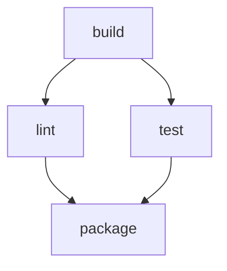

# DAG Dependencies, Conditional Tasks And Parallel Work

A continuous integration (CI) pipeline takes a change to the source code and runs a set of tasks on it: fetch the code, build it, lint it, test it and package the result. Some of these tasks must wait for others. A package cannot exist before the build finished, and nobody should publish a package whose tests failed. Other tasks do not need each other, and running them one after the other only makes the pipeline slow.

A pipeline engine needs a way to say which task waits for which. This part shows how Argo Workflows does it with a Directed Acyclic Graph (DAG): a set of tasks where each task names the tasks it depends on and no chain of dependencies leads back to the task where it started. It then explains which component decides when a task starts.

## The pieces of Argo Workflows

Argo Workflows is a Kubernetes add-on. It installs custom resource definitions, which add new object kinds to the Kubernetes API, and a controller that acts on them. The `Workflow` kind describes one run. The `WorkflowTemplate` kind stores a reusable definition that many runs can use.

The component that does the work is the **workflow controller**, a Deployment named `workflow-controller`. It watches `Workflow` objects. For every task that is ready to run, it creates a pod. When the pod finishes, the controller records the result in the `status` field of the `Workflow`. No other component schedules tasks, and the Kubernetes scheduler only decides on which node each pod runs.

Each workflow has an `entrypoint`, the name of the template that starts the run. A template is either a leaf that runs a container, or a DAG that arranges other templates. The example below has one leaf template called `step` and one DAG template called `pipeline`.

## A first DAG

Think of the pipeline as a diamond: `build` runs first, `lint` and `test` run next, and `package` runs when both of them finished. The shape of the graph is this.



The diagram shows two independent branches between `build` and `package`. Nothing connects `lint` and `test`, so the controller can run them at the same time.

<!-- astrona:playground:renew -->
Save this as `workflowtemplate-diamond.yaml`:

```yaml
apiVersion: argoproj.io/v1alpha1
kind: WorkflowTemplate
metadata:
  name: diamond
  namespace: starfleet
spec:
  entrypoint: pipeline
  serviceAccountName: workflow-runner
  templates:
    - name: pipeline
      dag:
        tasks:
          - name: build
            template: step
            arguments:
              parameters:
                - name: label
                  value: build
          - name: lint
            depends: build
            template: step
            arguments:
              parameters:
                - name: label
                  value: lint
          - name: test
            depends: build
            template: step
            arguments:
              parameters:
                - name: label
                  value: test
          - name: package
            depends: lint && test
            template: step
            arguments:
              parameters:
                - name: label
                  value: package
    - name: step
      inputs:
        parameters:
          - name: label
      container:
        image: alpine:3.23
        command: [sh, -c]
        args: ["echo running {{inputs.parameters.label}}; sleep 10"]
```

Each task has a `name`, a `template` to run and a `depends` expression. The task `build` has no `depends`, so it is ready at once. The task `package` has `depends: lint && test`, so it waits for both. The `step` template is the leaf: it starts one container, prints a line and sleeps for ten seconds, so the timing differences are easy to see. The `serviceAccountName` is the Kubernetes service account that the task pods run as; the playground created it with the one permission the executor needs.

Apply it:

```sh
kubectl apply -f workflowtemplate-diamond.yaml
```

A `WorkflowTemplate` does not run anything by itself. Save this as `workflow-diamond-run.yaml`, which starts one run from the template:

```yaml
apiVersion: argoproj.io/v1alpha1
kind: Workflow
metadata:
  name: diamond-run
  namespace: starfleet
spec:
  workflowTemplateRef:
    name: diamond
```

Create it and wait for the result:

```sh
kubectl create -f workflow-diamond-run.yaml
kubectl -n starfleet wait --for=jsonpath='{.status.phase}'=Succeeded workflow/diamond-run --timeout=180s
```

## Reading the timing

The workflow status keeps one node for each task and records when its pod started and finished. This command prints those times for the pod nodes, sorted by start time:

```sh
kubectl -n starfleet get workflow diamond-run -o json | jq -r '.status.nodes[] | select(.type=="Pod") | [.displayName, .phase, .startedAt, .finishedAt] | @tsv' | sort -k3
```

Read the result in this order. `build` starts first. The start times of `lint` and `test` are within a second or two of each other and both are later than the finish time of `build`. The start time of `package` is later than the finish time of both. The exact timestamps depend on your cluster, so compare them with each other and not with a clock.

That overlap is what parallel work means here: the controller created the two pods in the same reconciliation, because both tasks became eligible when `build` succeeded. The workflow finishes in about three task durations (build, then the slower of lint and test, then package) instead of four.

## Why the graph must be acyclic

Suppose `lint` depended on `package` and `package` depended on `lint`. Neither could ever be ready, because each would wait for the other. A graph with such a loop has no valid forward order. Argo Workflows checks the structure when it receives the object and rejects a workflow that has a cycle, so the mistake shows up at submission and not as a run that never ends.

Acyclic does not mean that every task has one child or one parent. A task can start several branches, which is a fan-out, and a task can wait for several branches, which is a fan-in. The diamond has both: `build` fans out and `package` fans in.

## Ready is not the same as running

A task is eligible when its `depends` condition is true. That does not mean its pod runs at once. The workflow controller creates the pod, and then Kubernetes must find a node with enough CPU and memory, pull the image and start the container. If the cluster is full or an image cannot be pulled, an eligible task stays `Pending`. The graph is correct in that case, and the problem is in the infrastructure.

This distinction matters when you read a slow pipeline. A task that waits for its dependencies has no pod yet. A task that is eligible but waiting for the cluster has a pod in the `Pending` state. Check which of the two you see before you change the graph.

## The result of a pipeline

For CI, the useful output of a pipeline is an artifact that is known to have passed its checks, such as a container image built from one source revision. The DAG is what ties the artifact to the checks. If `package` depends on `lint` and `test`, then an existing package means that both checks succeeded for this run. If `package` depended only on `build`, a package could exist for code that failed its tests, and the pipeline would hide that failure.

The pipeline should also hold only the permissions it needs. A CI task that compiles code does not need the right to change a production cluster. The `workflow-runner` service account in the playground can only report task results, which is the smallest set that the executor needs.

This part showed how dependencies order the tasks and how independent branches run in parallel. The next question is what happens when a task fails or when a task should be skipped: a dependency can test more than success.

## Common pitfalls

> [!WARNING]
> A `WorkflowTemplate` does not start a run, so create a `Workflow` that refers to it. A task that depends only on `build` can run while the tests are still running. Eligible does not mean running: a pod can stay `Pending` because of the cluster and not because of the graph.
