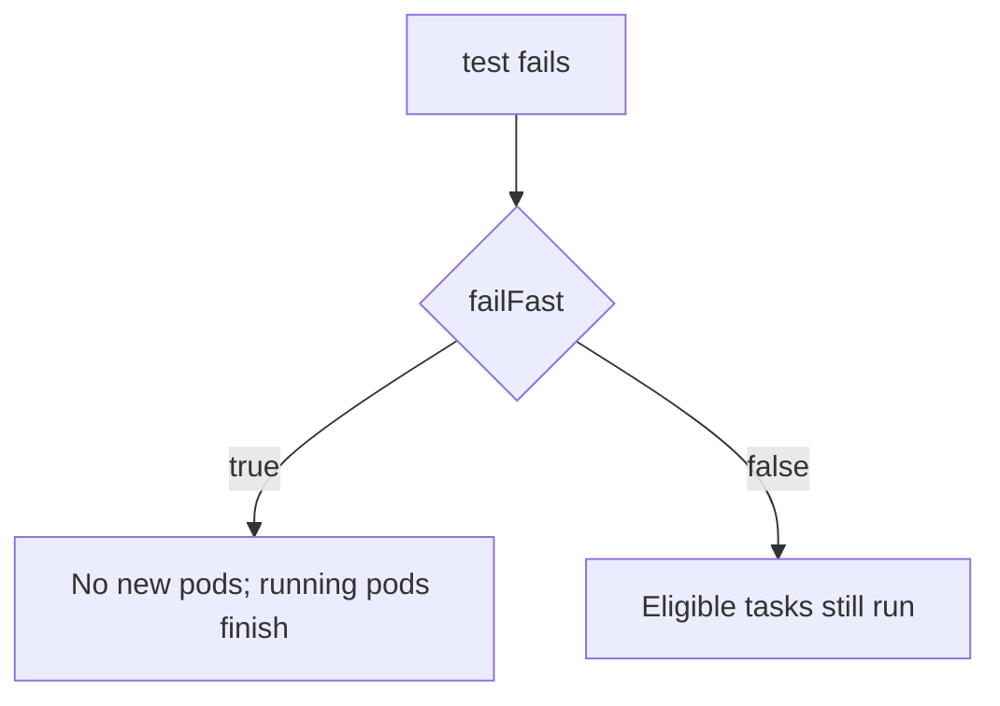

# Conditional Tasks, Failure And Retries

A pipeline that only handles success is not finished. Tests fail, a registry has a short outage, and some tasks must run only for certain inputs, for example a publish task that runs on the main branch and not on a feature branch. The pipeline engine needs rules for each of these cases, and the rules decide what the next person sees when they open a failed run.

This part covers three tools: the `depends` expression, which reacts to the result of an earlier task, the `when` expression, which skips a task for a given input, and the retry strategy, which runs a task again after a failure. It also explains what the DAG does when a task fails.

## Task results

Every task in a DAG ends with one result. The `depends` expression can test these results by writing the task name, a dot and the result name.

- `Succeeded`: the task ran and its container exited with code 0.
- `Failed`: the task ran and its container exited with a non-zero code.
- `Errored`: the engine could not run the task, for example because a pod could not be created.
- `Skipped`: the task did not run because its `when` expression was false, or because a dependency was skipped.
- `Completed`: any of the results above except `Skipped`, which is the right test for "after it finished, whatever happened".
- `Daemoned`: the task is a daemon that is running.

A bare task name such as `depends: build` is shorthand for `build.Succeeded || build.Skipped || build.Daemoned`. That default is why a skipped task does not block its children. Expressions can combine results with `&&`, `||`, `!` and parentheses, for example `lint.Succeeded && (test.Succeeded || test.Skipped)`.

The older `dependencies` field is a plain list of task names. It means the same as the default shorthand. A task cannot use both `depends` and `dependencies`, so a pipeline picks one form. Use `depends` when a result other than success matters.

## A task that runs after a failure

A cleanup or a report task must run even when the tests failed. The default condition would never start it, because it only fires after success. A report task in a DAG looks like this:

```yaml
          - name: report
            depends: package.Completed || test.Failed || lint.Failed
            template: step
            arguments:
              parameters:
                - name: label
                  value: report
```

The task `report` is eligible after `package` finished, or after `test` or `lint` failed. A task like this is a fit for collecting logs or sending a notification. It is not a fit for publishing a package, because the condition says "continue even though something failed".

The condition states the business reason for continuing. A diagnostic step may run after any result. A publish step must run only after every required check succeeded. Make that decision in the graph and not in a script that later tries to detect a half-finished state.

## Conditional tasks with when

A `when` expression decides whether an eligible task runs. The expression is evaluated after the dependencies are satisfied and after parameters are substituted. If it is false, the task gets the result `Skipped` and no pod is created.

<!-- astrona:playground:renew -->
Save this as `workflowtemplate-conditional.yaml`:

```yaml
apiVersion: argoproj.io/v1alpha1
kind: WorkflowTemplate
metadata:
  name: conditional
  namespace: starfleet
spec:
  entrypoint: pipeline
  serviceAccountName: workflow-runner
  arguments:
    parameters:
      - name: publish
        value: "false"
  templates:
    - name: pipeline
      dag:
        tasks:
          - name: test
            template: step
            arguments:
              parameters:
                - name: command
                  value: "echo tests passed"
          - name: publish
            depends: test
            when: "{{workflow.parameters.publish}} == true"
            template: step
            arguments:
              parameters:
                - name: command
                  value: "echo published"
    - name: step
      inputs:
        parameters:
          - name: command
      container:
        image: alpine:3.23
        command: [sh, -c]
        args: ["{{inputs.parameters.command}}"]
```

Apply it:

```sh
kubectl apply -f workflowtemplate-conditional.yaml
```

Save this as `workflow-conditional-run.yaml`. It uses the default value of the parameter, which is `false`:

```yaml
apiVersion: argoproj.io/v1alpha1
kind: Workflow
metadata:
  name: conditional-run
  namespace: starfleet
spec:
  workflowTemplateRef:
    name: conditional
```

Create it, wait for it and print the phase of each task:

```sh
kubectl create -f workflow-conditional-run.yaml
kubectl -n starfleet wait --for=jsonpath='{.status.phase}'=Succeeded workflow/conditional-run --timeout=180s
kubectl -n starfleet get workflow conditional-run -o json | jq -r '.status.nodes[] | select(.displayName=="test" or .displayName=="publish") | [.displayName, .phase] | @tsv'
```

The task `test` shows `Succeeded`, and the task `publish` shows `Skipped`, because `false == true` is false. The workflow as a whole is `Succeeded`: a skipped task is not a failure. A run for the main branch would set the parameter to `true`, and then `publish` would get a pod.

## What happens when a task fails

Argo Workflows treats a DAG as failed when a task fails and nothing handles the failure. By default a DAG has fail-fast on. After the first failure, the controller stops creating pods for tasks that have not started. Tasks whose pods already run continue until they finish, and the workflow ends as `Failed` after they do.

You can turn fail-fast off with `failFast: false` on the DAG template. The controller then keeps scheduling every task whose condition is true, so independent branches finish and their results are visible in one run. That setting trades speed of feedback for completeness: a pipeline for a large monorepo may prefer to see all failing checks at once, while a short pipeline may prefer to stop early and save cluster time.



The diagram shows the only difference: whether tasks that are still eligible get a pod after a failure. In both cases, a task that already finished keeps its side effects, and nothing is rolled back.

## Retries

Some failures are temporary: a registry returns an error for ten seconds, or a test needs a database that is not ready yet. A `retryStrategy` on a template tells the controller to run the task again in a new pod when it fails.

```yaml
    - name: flaky-test
      retryStrategy:
        limit: 3
        retryPolicy: OnFailure
        backoff:
          duration: 5s
          factor: 2
      container:
        image: alpine:3.23
        command: [sh, -c]
        args: ["test {{retries}} -ge 2"]
```

The field `limit` is the maximum number of retries. `retryPolicy: OnFailure` retries when the container exits with a non-zero code. The `backoff` block waits `5s` before the first retry and doubles the wait for each next one. The variable `{{retries}}` holds the number of the current retry, starting at `0`. In the example, the first two attempts exit with an error and the third attempt succeeds, which is the pattern of a temporary fault.

A retry is a new pod, so a task that is retried must be safe to repeat. A task that appends a row to a database on each run can write the row three times. Use writes that can be repeated safely, such as "set this value", or give the run an identity that the target can use to ignore duplicates.

## Reading a failed run

To find the first failure, list the pod nodes with their phase and message, and sort by start time:

```sh
kubectl -n starfleet get workflow <name> -o json | jq -r '.status.nodes[] | select(.type=="Pod") | [.startedAt, .displayName, .phase, (.message // "")] | @tsv' | sort
```

Replace `<name>` with the name of the run. The earliest `Failed` row is the task that started the failure. Tasks that show `Omitted` or no row were never started because of fail-fast. Then read the log of that pod with `kubectl -n starfleet logs <pod>`, where the pod name is in the `id` field of the node. Fix the cause that the log shows, and do not rewrite the graph to hide the failed task.

The conditions in this part say what the pipeline does with a result. The next question is how a task passes its data on, and what limits how many tasks run at the same time.

## Common pitfalls

> [!WARNING]
> A bare task name in `depends` means success or skip, so a cleanup task needs `.Completed` or `.Failed`. A skipped task is not a failed task. Fail-fast does not stop running pods and does not undo what finished tasks did. A retry creates a new pod, so a non-repeatable task can do its work more than once.
