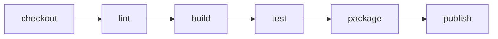

# Pipeline Stages And What Each One Proves

A pipeline is more than a list of commands. Each stage answers one question about a change to the source code, and the answers come in a fixed order from cheap to expensive. If an early stage fails, the pipeline stops before it spends time and cluster capacity on the later ones.

This part names the usual stages, says what each stage proves and shows how to write them as a chain of tasks in Argo Workflows. It ends with the rule that decides where a stage belongs: the stage must fail for a reason that the developer can act on.

## The usual stages

A CI pipeline for a service normally has these stages. The names differ between teams, but the questions stay the same.

- **Checkout** fetches the source at one exact commit. It proves that the pipeline works on a known input.
- **Static checks** run a linter and a formatter. A linter reads the code without running it and reports mistakes and style problems. These checks are fast, so they run first.
- **Build** compiles the code or installs its dependencies. It proves that the change can be turned into something runnable.
- **Test** runs unit tests against the build. Unit tests check small pieces of code in isolation. Integration tests, which need other services, usually run later because they are slower.
- **Scan** looks for known vulnerabilities in dependencies and in the container image.
- **Package** creates the artifact, for example a container image, and gives it a version.
- **Publish** pushes the artifact to a registry, a server that stores images. Only a package that passed every earlier stage reaches this stage.

The pipeline does not deploy in this list. Deploying is the job of continuous delivery, which starts from the artifact that the pipeline published.



The diagram shows the cheap-to-expensive order. Each arrow means that the next stage starts only when the previous stage succeeded.

## Stages as Argo Workflows steps

A DAG lets stages run in parallel. A pipeline whose stages must run strictly one after the other can use `steps` instead. A `steps` template is a list of groups. The groups run in order, and the entries inside one group run at the same time.

<!-- astrona:playground:renew -->
Save this as `workflowtemplate-stages.yaml`:

```yaml
apiVersion: argoproj.io/v1alpha1
kind: WorkflowTemplate
metadata:
  name: stages
  namespace: starfleet
spec:
  entrypoint: pipeline
  serviceAccountName: workflow-runner
  templates:
    - name: pipeline
      steps:
        - - name: checkout
            template: stage
            arguments:
              parameters:
                - name: stage
                  value: checkout
        - - name: lint
            template: stage
            arguments:
              parameters:
                - name: stage
                  value: lint
          - name: build
            template: stage
            arguments:
              parameters:
                - name: stage
                  value: build
        - - name: test
            template: stage
            arguments:
              parameters:
                - name: stage
                  value: test
    - name: stage
      inputs:
        parameters:
          - name: stage
      container:
        image: alpine:3.23
        command: [sh, -c]
        args: ["echo running stage {{inputs.parameters.stage}}"]
```

Apply it:

```sh
kubectl apply -f workflowtemplate-stages.yaml
```

Save this as `workflow-stages-run.yaml`:

```yaml
apiVersion: argoproj.io/v1alpha1
kind: Workflow
metadata:
  generateName: stages-run-
  namespace: starfleet
spec:
  workflowTemplateRef:
    name: stages
```

Create the run:

```sh
kubectl create -f workflow-stages-run.yaml
```

The command prints the generated name of the workflow. List the workflows and read the phase of the newest one:

```sh
kubectl -n starfleet get workflows
```

The second group holds `lint` and `build`, so the two tasks start together. `test` starts only after both of them finished. A `steps` template has no `depends` expressions, so it is simpler to read, but it cannot say "start `package` when `lint` finished but `build` is still running".

## Where a stage belongs

Two rules place a stage. First, a stage that is cheap and fails often runs early. A lint error costs seconds, while an integration test costs minutes. Second, a stage that needs the result of another stage runs after it, and a stage that does not can run beside it.

A third rule matters for trust: a stage must fail for a reason the developer can act on. A test stage that fails because a registry was unreachable teaches the developer to ignore red pipelines. Network problems belong in a retry strategy. Real test failures belong in a red stage.

The stages in this part pass no data to each other yet. A build produces files, and a package stage needs those files, so the next part shows how tasks share them.

## Common pitfalls

> [!WARNING]
> Entries in one `steps` group run in parallel, and groups run in order, so a stage that must wait needs its own group. Running slow stages first delays the feedback from cheap checks. A pipeline that deploys inside the CI stages mixes two jobs and makes a failed deploy look like a failed build.
