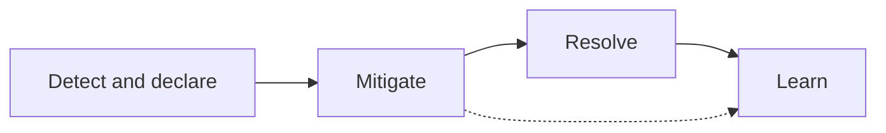

# Incident Roles, Severity And Evidence

An incident is an event that makes a service worse than the level that its users and its owners agreed on. For a platform team, the service is often a shared one: a cluster, a deployment pipeline or a base image that many application teams depend on. An incident is not defined by its cause. A service that returns errors because of a bad release and a service that returns errors because a node failed are both incidents, and the first questions are the same: who is affected, how badly, and who is working on it.

This part describes the roles in an incident, how severity is chosen, and which evidence a Kubernetes cluster keeps about a failure. It ends with a first hands-on step: record a baseline of a healthy service, so that later steps have something to compare with.

## Incident roles

During an incident, many people want to act at the same time. Without agreed roles, two people may change the same object, nobody informs the users, and nobody remembers what was tried. A small set of roles solves this. In a small team, one person can hold more than one role, but the duties stay separate.

- **Incident commander.** Decides what the team does next and keeps the overall picture. The commander does not type the fixes. The commander asks for them, and decides when a mitigation is good enough.
- **Operations lead.** Runs the commands that change the system. Only the operations lead changes production objects, so that changes are ordered and every change has an owner.
- **Communications lead.** Tells the affected teams and the users what is known, what is not known and when the next update comes. This keeps the others free to work.
- **Scribe.** Writes the timeline: what was seen, what was decided, what was changed and at what time.

The reason for the split is to protect the one scarce resource in an incident, which is attention. The commander watches the whole problem, the operations lead watches the cluster, and the others do not have to interrupt them.

## Severity describes impact, not cause

A severity level tells the organisation how much attention an incident needs. It is chosen from the impact: how many users or teams are affected, whether data is at risk, and whether a workaround exists. The cause is usually not known yet when the level is chosen, so the level must not depend on it. A common scale has three or four levels. The highest level means a full outage or a risk to data, and the lowest means a small degradation with a workaround.

The level can change during the incident. A degraded service that turns into a full outage is raised, and a service that is restored is lowered. Each change is written in the timeline with the time and the reason.

## The order of work

The work of an incident has a fixed order, and each step has a different goal.

1. **Detect and declare.** Someone notices the problem and declares an incident. The roles are assigned and a severity is chosen.
2. **Mitigate.** The team reduces the impact as fast as possible. A rollback, a scale-up or a traffic switch is a mitigation. The service does not have to be fully understood to do this.
3. **Resolve.** The cause is removed and the service returns to its agreed level.
4. **Learn.** The team reviews the timeline, finds the contributing factors and writes follow-up actions.

Mitigation comes before root cause analysis because every minute of analysis is also a minute of impact. A rollback to a revision that worked yesterday is allowed to be a blunt tool. The analysis can happen after the users are served again.



The dotted line shows that evidence collected during mitigation is used in the review. It is easy to lose, so the scribe records it while it is fresh.

## Evidence that Kubernetes keeps

Kubernetes stores the desired state of every object in its API, and each controller writes its observations back into the `status` of that object. During an incident, these observations are the evidence.

- **Deployment status and conditions.** A Deployment has the conditions `Available` and `Progressing`. They say whether enough pods are ready and whether a rollout is moving. Each condition has a `reason`, such as `ProgressDeadlineExceeded`.
- **ReplicaSets.** A Deployment creates one ReplicaSet for each revision of its pod template. The list of ReplicaSets, with their ages and replica counts, is the history of the rollouts.
- **Pod states.** A pod has a phase and, for each container, a state. A waiting container has a `reason` such as `ImagePullBackOff`, and a terminated container has an exit code.
- **Events.** Controllers and the kubelet, the agent on each node, write short event objects such as `Failed to pull image` or `Back-off restarting failed container`. The API server removes events after a time to live, one hour by default, so they must be copied into the timeline during the incident.
- **Logs.** Container logs show what the application printed. They exist only for containers that ran, so a pod that never started has no logs, and its events are the only evidence.

Reading evidence in a fixed order saves time: the Deployment first, then the ReplicaSets, then the pods, then the events of the failing pod, and the logs last.

<!-- astrona:playground:renew -->
## Try it: record the baseline of a healthy service

The playground has a Deployment `scout` in the namespace `starfleet` with two replicas of a small web service, and a Service `scout` in front of them. Start with the question that every incident starts with: what does the healthy state look like? Read it before anything changes.

```sh
kubectl -n starfleet get deploy,rs,pods,svc
kubectl -n starfleet get endpointslices -l kubernetes.io/service-name=scout
kubectl -n starfleet rollout history deploy/scout
```

The Deployment shows `2/2` ready. There is one ReplicaSet with two pods, and the history has one revision. The EndpointSlice lists the addresses of the two ready pods. These objects are the baseline: after a failure, any difference from them is a lead.

## Try it: write the incident record

The scribe keeps the record in one place that every responder can read. In this module it is a ConfigMap named `incident-record`. A ConfigMap is a Kubernetes object that stores small pieces of text as keys and values, so the record lives next to the service that it describes.

Save this as `incident-record.yaml`:

```yaml
apiVersion: v1
kind: ConfigMap
metadata:
  name: incident-record
  namespace: starfleet
data:
  service: scout
  severity: "2"
  status: investigating
  timeline: |
    baseline recorded: 2 of 2 replicas ready, 1 revision
```

Apply it:

```sh
kubectl apply -f incident-record.yaml
```

Check it:

```sh
kubectl -n starfleet get configmap incident-record -o jsonpath='{.data.timeline}'
```

The command prints the one timeline line. Every later step in this module adds a line to this record. The record is plain data, so it can be changed with `kubectl edit configmap incident-record -n starfleet` or by applying the file again with more lines.

## Why the record is kept outside the head of the responders

A timeline written after the incident is built from memory, and memory reorders events. A timeline written during the incident has the actual order and the actual time of each step. It also lets a second responder join without a long explanation: reading the record is enough. The review at the end uses the same record, so a detail that was written down is a detail that can be examined.

This part gave the roles, the order of work and the sources of evidence. The next part uses them on a real failure: a release that cannot start, and the fastest safe way to restore the service.

## Common pitfalls

> [!WARNING]
> Severity is chosen from impact, not from the suspected cause, and it can change during the incident. Events expire after about one hour, so copy the important ones into the record while they exist. A pod that never started has no logs, so a missing log is not a sign that the logging is broken.
