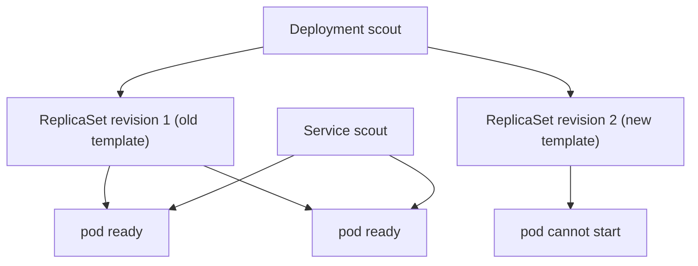

# Mitigation First: Rolling Back A Bad Release

Most platform incidents start with a change. A new image, a new configuration or a new version of a shared component is released, and shortly afterwards something stops working. When the change is a Deployment update, Kubernetes keeps the previous revision, and going back to it is the fastest mitigation that exists. To use it with confidence, you need to know what a rolling update does to the old pods while the new ones fail, and what a rollback changes in the cluster.

This part explains the rolling update mechanism, shows what a failed rollout looks like in the status, and then restores the service with `kubectl rollout undo`.

## What a Deployment does when the pod template changes

A Deployment does not run pods itself. It owns ReplicaSets, and each ReplicaSet keeps a fixed number of identical pods. A ReplicaSet is tied to one version of the pod template, the part of the Deployment that describes the containers. When the template changes, for example when the image changes, the Deployment controller creates a new ReplicaSet for the new template. It then moves the replicas from the old ReplicaSet to the new one in steps.

The size of each step is set by two numbers in the rolling update strategy.

- `maxSurge` is how many pods above the desired number may exist during the update. The default is 25 percent, rounded up.
- `maxUnavailable` is how many of the desired pods may be unavailable during the update. The default is 25 percent, rounded down.

With two replicas, 25 percent of two is 0.5. `maxSurge` rounds up to 1 and `maxUnavailable` rounds down to 0. The consequence is important for an incident: the controller creates one new pod, and it may remove an old pod only when the new pod is ready. If the new pod never becomes ready, the old pods are never removed.



The Service sends traffic only to ready pods. The two old pods are ready and the new pod is not, so users keep being served while the rollout is stuck. A bad release with these defaults is therefore a stalled rollout and not an outage, as long as the old pods keep running.

## How a stalled rollout is reported

The Deployment has a field `progressDeadlineSeconds`. If the rollout makes no progress for that many seconds, the controller sets the condition `Progressing` to `False` with the reason `ProgressDeadlineExceeded`. The default is 600 seconds. The playground sets 60 seconds, so the evidence appears sooner.

Kubernetes does not roll back by itself. The controller reports the condition and stops there. Deciding to go back is the job of the people in the incident, or of a delivery tool that was configured to do it.

## Revisions and the rollback command

Each ReplicaSet of a Deployment keeps the annotation `deployment.kubernetes.io/revision`. The Deployment keeps old ReplicaSets, scaled to zero, up to `revisionHistoryLimit`, which is 10 by default. These retained ReplicaSets are what makes a rollback possible: the old pod template is still stored in the cluster.

`kubectl rollout undo deployment/scout` writes the pod template of the previous revision back into the Deployment. The controller then treats it like any other change: it scales the matching ReplicaSet up and the failing one down. The rollback creates a new revision number for the restored template, so the history shows what happened and in which order. A rollback is a normal update to the Deployment object, and it is recorded like one.

<!-- astrona:playground:renew -->
## Try it: release a bad image tag

In the playground, `scout` runs version 6.15.0 of the image. The release below changes the image to a tag that does not exist, which is a common mistake: a version number is typed wrongly in the pipeline.

Save this as `scout-bad-release.yaml`:

```yaml
spec:
  template:
    spec:
      containers:
        - name: scout
          image: ghcr.io/stefanprodan/podinfo:6.15.99
```

Apply it:

```sh
kubectl -n starfleet patch deploy/scout --patch-file scout-bad-release.yaml
```

The file is a strategic merge patch. Kubernetes merges the container list by the key `name`, so only the image of the container `scout` changes.

Check it:

```sh
kubectl -n starfleet get pods -l app=scout
kubectl -n starfleet get rs -l app=scout
```

There are now two ReplicaSets. The old one still has two ready pods. The new one has one pod that is not ready, and its status shows `ErrImagePull` and then `ImagePullBackOff`. The kubelet cannot pull the image, and it waits a longer time after each failed attempt, which is what `BackOff` means.

Read the evidence the way an operations lead would, from the Deployment to the event:

```sh
kubectl -n starfleet rollout status deploy/scout --timeout=90s
kubectl -n starfleet get deploy scout -o jsonpath='{.status.conditions[?(@.type=="Progressing")].reason}'
kubectl -n starfleet get events --field-selector reason=Failed --sort-by=.lastTimestamp
```

After about 60 seconds, `rollout status` stops with a message that the progress deadline was exceeded, and the condition reason is `ProgressDeadlineExceeded`. The events contain the failed pull of the tag `6.15.99`. That event is the root cause evidence, and it also shows that the fault is in the release and not in the cluster.

Mitigation does not need this analysis. Still, copying the event line into the record now is cheap, and the event will expire.

## Try it: roll back

Look at the revisions, then go back to the previous one:

```sh
kubectl -n starfleet rollout history deploy/scout
kubectl -n starfleet rollout undo deploy/scout
kubectl -n starfleet rollout status deploy/scout --timeout=120s
```

The history lists two revisions before the undo. The undo returns the template with the image tag `6.15.0`, and it becomes a third revision. `rollout status` reports that the rollout completed. Confirm the result from the point of view of the users:

```sh
kubectl -n starfleet get deploy scout -o jsonpath='{.spec.template.spec.containers[0].image}{"\n"}'
kubectl -n starfleet get endpointslices -l kubernetes.io/service-name=scout
```

The image is `ghcr.io/stefanprodan/podinfo:6.15.0` again, and the EndpointSlice lists two ready addresses. The service never lost its two ready pods, because the old ReplicaSet kept them during the stalled rollout.

## What a rollback does not do

A rollback restores the pod template and nothing else. It does not undo a change to a ConfigMap that the new release also needed, a database migration that ran, or a change that was made to another object. If the release changed more than the Deployment, the rollback can leave the cluster in a state that no revision describes. For that reason, a release that changes several objects needs a written plan to go back, and the record should list every object that the release touched.

This part restored a service by going back to a known revision. The next part covers faults that a rollback does not fix, such as a missing configuration key or a probe that never succeeds.

## Common pitfalls

> [!WARNING]
> With two replicas, the default rolling update never removes an old pod before the new pod is ready, so a failed rollout stalls and does not cause an outage. Kubernetes does not roll back on its own after `ProgressDeadlineExceeded`. A rollback restores only the pod template of the Deployment, not other objects that the release changed.
