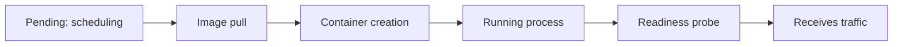

# Configuration Faults, Crash Loops And Readiness

A rollback fixes a release that went wrong, but not every failure is a release. A pod can fail because its configuration is incomplete, because its process exits, or because it never reports that it is ready. Each of these faults leaves a different mark in the pod status, and each needs a different fix. The skill that this part builds is classification: reading the status of a pod and naming the class of the fault in the first minute, before choosing a mitigation.

This part describes the four classes that occur most often on a platform, the status that identifies each one, and the component that reports it. It then reproduces two of them and fixes them.

## The life of a pod, and where it can stop

A pod passes through stages, and a fault shows up at the stage where it stops.

1. **Scheduling.** The scheduler assigns the pod to a node. A pod that cannot be placed stays `Pending` with the reason `Unschedulable`, for example when no node has enough free memory.
2. **Image pull.** The kubelet pulls the image. A failure here gives `ErrImagePull`, and then `ImagePullBackOff` while the kubelet waits before it tries again.
3. **Container creation.** The kubelet prepares the container, including its environment variables and mounted volumes. If a referenced ConfigMap or Secret key does not exist, the container cannot be created, and the reason is `CreateContainerConfigError`.
4. **Running.** The process starts. If it exits with an error, the kubelet restarts it with a growing delay, and the state is `CrashLoopBackOff`.
5. **Ready.** The kubelet runs the readiness probe. Only when it succeeds does the pod become ready and receive traffic from Services.



A fault at stage 2 or 3 means the container never ran, so there are no logs. A fault at stage 4 means the container ran and exited, so `kubectl logs --previous` shows what the last attempt printed. A fault at stage 5 means the process runs but fails the check, and the pod is `Running` with `0/1` ready.

## The four classes

- **Image pull failure.** Status: `ErrImagePull` or `ImagePullBackOff`. Typical causes are a wrong tag, a missing registry credential or an unreachable registry. The event names the image and the registry error. A rollback fixes it when the tag came from the release.
- **Configuration error.** Status: `CreateContainerConfigError`. The pod refers to a ConfigMap, a Secret or a key that does not exist. The event names the missing key. A rollback may not fix it, because the missing object is outside the Deployment.
- **Crash loop.** Status: `CrashLoopBackOff` with a non-zero exit code. The process starts and stops. The cause is in the application, its arguments or its environment, and the logs of the previous attempt show it.
- **Failed readiness.** Status: `Running` but not ready. The process works, but the readiness probe fails, or the probe checks the wrong thing. The pod is removed from the Service endpoints, so users see a reduced capacity or no capacity at all.

The status names are reported by the kubelet. The controller of the Deployment does not interpret them. It only counts how many pods are ready, which is why the Deployment condition says `Progressing` and the pod status says why.

## Readiness and the Service

A Service selects pods by label and sends traffic to the addresses in its EndpointSlices. The endpoints controller puts a pod into the EndpointSlice as ready only when the pod reports the `Ready` condition. A pod whose readiness probe fails stays in the EndpointSlice with `ready: false` and receives no traffic. If all pods fail the probe, the Service has no ready endpoints, and requests are refused even though every container is running. This is the case where `kubectl get pods` shows `Running` and the service is still down.

<!-- astrona:playground:renew -->
## Try it: a missing configuration key

The Deployment `probe` below reads the environment variable `MODE` from the key `mode` of the ConfigMap `probe-config`. The ConfigMap exists, but it has no key `mode`.

Save this as `probe.yaml`:

```yaml
apiVersion: v1
kind: ConfigMap
metadata:
  name: probe-config
  namespace: starfleet
data:
  region: outpost
---
apiVersion: apps/v1
kind: Deployment
metadata:
  name: probe
  namespace: starfleet
spec:
  replicas: 1
  selector:
    matchLabels:
      app: probe
  template:
    metadata:
      labels:
        app: probe
    spec:
      containers:
        - name: probe
          image: ghcr.io/stefanprodan/podinfo:6.15.0
          ports:
            - name: http
              containerPort: 9898
          env:
            - name: MODE
              valueFrom:
                configMapKeyRef:
                  name: probe-config
                  key: mode
          readinessProbe:
            httpGet:
              path: /readyz
              port: http
```

Apply it:

```sh
kubectl apply -f probe.yaml
```

Check it:

```sh
kubectl -n starfleet get pods -l app=probe
kubectl -n starfleet describe pod -l app=probe
```

The pod stays in `CreateContainerConfigError`. At the end of the `describe` output, the events say that the key `mode` is missing from the ConfigMap `probe-config`. There are no logs, because the container was never created: `kubectl logs` for this pod returns an error that the container is waiting to start.

The fix is to add the key to the ConfigMap, not to remove the reference from the Deployment. The Deployment declares what the application needs, and the ConfigMap was incomplete.

```sh
kubectl -n starfleet patch configmap probe-config --type merge -p '{"data":{"mode":"standard"}}'
```

The kubelet retries container creation by itself, so the pod does not need to be deleted. Wait for the retry and check:

```sh
kubectl -n starfleet rollout status deploy/probe --timeout=120s
```

The rollout completes and the pod is `1/1` ready.

## Try it: a probe that checks the wrong port

The application listens on port 9898. The patch below points the readiness probe to port 9899, where nothing listens. A wrong port in a probe is a typical copy mistake.

Save this as `probe-wrong-port.yaml`:

```yaml
spec:
  template:
    spec:
      containers:
        - name: probe
          readinessProbe:
            httpGet:
              path: /readyz
              port: 9899
```

Apply it:

```sh
kubectl -n starfleet patch deploy/probe --patch-file probe-wrong-port.yaml
```

Check it:

```sh
kubectl -n starfleet get pods -l app=probe
kubectl -n starfleet describe pod -l app=probe
```

The new pod is `Running` with `0/1` ready, and the old pod stays because the new one is not ready. The events show `Readiness probe failed` with a connection refused error. Logs show a healthy application, which proves the process is fine and that the check is wrong. Set the port back to `http` (the name of the container port) with a second patch, or apply `probe.yaml` again, and the rollout completes.

## Choosing the mitigation from the class

The class decides the first action. For an image pull failure from a release, roll back. For a configuration error, fix the missing object, because a rollback of the Deployment does not recreate it. For a crash loop, read the previous logs, and roll back if the cause is in the new release. For a failed readiness probe, compare the probe with the application port and path. If the probe is correct and the application is the problem, roll back.

In every case, add one line to the incident record with the class, the evidence that identified it and the action taken. That line is the input to the review.

## Common pitfalls

> [!WARNING]
> A pod in `CreateContainerConfigError` has no logs, so look at its events instead. A running pod can still be down for users when its readiness probe fails, so compare the ready count and the EndpointSlice, not only the pod phase. Do not remove a reference to a missing ConfigMap key to make the pod start, because the application then runs without the setting that it needs.
