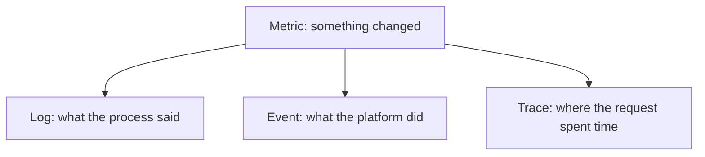

# Signals: Metrics, Logs, Events And Traces

An incident starts as a difference between what the system should do and what it does. Nobody can see that difference without data. A platform team needs several kinds of data because each kind answers a different question, and none of them answers all questions.

This part names the four kinds of signals, says which question each one answers, and then shows the two signals that every Kubernetes cluster has without extra tools: events and container logs.

## The four signals

A **metric** is a number that is measured over time, for example the number of requests per second or the restarts of a container. Metrics are small and cheap to store, so they are the basis for graphs and alerts. A metric says that something changed, but not why.

A **log** is a line of text that a program writes about something that happened. Logs carry detail such as an error message or a request identifier. They answer "what exactly happened in this process".

An **event** in Kubernetes is an object that a component creates when it changes something or finds a problem, for example the scheduler placing a pod or the kubelet failing to pull an image. Events answer "what did the platform do or fail to do to this object". Events are kept for a short time, about one hour by default.

A **trace** follows one request through several services and records how long each step took. Traces answer "which service made this request slow". A cluster needs a tracing system, such as OpenTelemetry with a backend, to have them.



The diagram shows the usual order of use: a metric tells the team where to look, and the other three signals explain the cause.

## Pod status as a signal

Kubernetes already exposes health in the status of each object. The status of a pod shows its phase and, for each container, whether it is ready and how often it restarted. The `READY` column of `kubectl get pods` shows ready containers out of the total, and the `RESTARTS` column counts restarts.

<!-- astrona:playground:renew -->
List the pods in the namespace of the playground:

```sh
kubectl -n starfleet get pods
```

A healthy pod shows `Running` and, for example, `1/1` ready. A pod in a crash loop shows the status `CrashLoopBackOff` and a growing restart count. A pod that runs but fails its readiness probe shows `Running` with `0/1` ready: the container is alive, but Kubernetes keeps it out of the endpoints of its Service. The three states are different symptoms and have different causes.

## Reading events

Events show the reason for a state. The command below lists the newest events of a namespace last:

```sh
kubectl -n starfleet get events --sort-by=.lastTimestamp
```

Each row has a type (`Normal` or `Warning`), a reason such as `Scheduled`, `Pulled`, `Failed` or `BackOff`, the object and a message. Warnings are the rows to read first. For one object, `kubectl describe` prints its events at the end:

```sh
kubectl -n starfleet describe deploy scout
```

Events are the platform's own explanation. An image that cannot be pulled, a probe that fails and a pod that cannot be scheduled all create a Warning event with a reason and a message that name the cause.

## Reading logs

A container writes its output to standard output, and the kubelet keeps it. The command prints the log of one container:

```sh
kubectl -n starfleet logs deploy/scout
```

For a container that already restarted, the current log is empty or new. The option `--previous` prints the log of the earlier run of the container:

```sh
kubectl -n starfleet logs deploy/scout --previous
```

If the pod has never restarted, this command reports that no previous container exists, which is the correct answer. Logs show what the application said. A container that exits at once with no log line still leaves its exit code in the pod status.

## Which signal first

Start with the signal that is cheapest and nearest to the symptom. Pod status shows in seconds whether the problem is a crash, a stuck start or a failing probe. Events then give the platform's reason. Logs give the application's reason. Metrics and traces cover what the cluster does not keep: trends over days and the path of a slow request.

The signals above show a state at the moment you look. The next question is which state should wake a person.

## Common pitfalls

> [!WARNING]
> Events expire after about an hour, so evidence must be saved early in an incident. `kubectl logs` on a restarted container shows the new run, not the failed one, unless you add `--previous`. A `Running` status does not mean ready, because the readiness column can still be `0/1`. A metric shows that something changed, and it cannot tell the cause alone.
