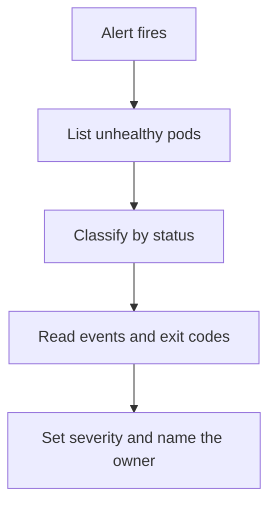

# Scoping An Incident From The First Alert

The first minutes of an incident decide how well the rest goes. The responder does not know the cause yet, but can already learn how many workloads are affected and how they fail. That knowledge sets the severity and tells the team where to look.

This part gives a short procedure for scoping with `kubectl`: find the workloads that are not healthy, classify each failure by its status and read the exit code of a container that stopped.

## Find everything that is not healthy

A cluster has many namespaces, and the alert names only one symptom. Start by listing the pods that are not in the `Running` or `Succeeded` phase in every namespace:

<!-- astrona:playground:renew -->
```sh
kubectl get pods -A --field-selector=status.phase!=Running,status.phase!=Succeeded
```

A pod in a crash loop is in the phase `Running` between restarts, so this list can miss it. A second view shows the ready column and the restarts for all pods:

```sh
kubectl get pods -A
```

Read the columns `READY`, `STATUS` and `RESTARTS`. Any pod that shows less than all containers ready, a status other than `Running` or a high restart count belongs on the list. Write down the names, because the incident record needs them.

## Classify each failure by its status

The status text tells the class of the failure, and each class points to a different next step.

- `Pending`: the scheduler has not placed the pod. Read the events for `FailedScheduling`, which names the reason, such as insufficient CPU or a taint.
- `ImagePullBackOff` or `ErrImagePull`: the node cannot pull the image. The reason is a wrong name or tag, a missing registry credential or a registry outage.
- `CrashLoopBackOff`: the container starts and exits again and again. Read the exit code and the previous log.
- `Running` with `0/1` ready: the container is alive and fails its readiness probe. Read the probe and the application log.
- `CreateContainerConfigError`: a referenced ConfigMap, Secret or key is missing.
- `OOMKilled` as the last state: the container used more memory than its limit.

## Read the exit code

A container that stopped keeps its last state in the pod status. The command below prints the last exit code of the first container of each pod that has one:

```sh
kubectl -n starfleet get pods -o jsonpath='{range .items[*]}{.metadata.name}{"\t"}{.status.containerStatuses[0].lastState.terminated.exitCode}{"\n"}{end}'
```

An empty value means the container has not terminated before. Exit code `0` is a normal exit. A code from `1` to `127` is an exit that the program chose. Code `137` means the process got the signal `SIGKILL`, which is typical for an out-of-memory kill, and code `143` means `SIGTERM`, a normal stop request. Together with the log, the code separates an application bug from a platform kill.

## Decide the scope

After one pass, the responder can answer four questions.

- How many workloads are affected, and in how many namespaces?
- Is the failure one class or several?
- Did all failures start at about the same time? Sort the events by time to find out.
- What changed shortly before? A rollout, a new node, a changed quota or a certificate renewal are common causes.

Many workloads that fail the same way at the same moment suggest a shared cause: a node, a registry, a quota or a controller. One workload that fails alone suggests a problem in that workload or its last release.



The diagram shows the order of the first pass: list, classify, read the evidence, then set severity and choose who leads. The pass takes minutes, and it prevents the common mistake of fixing the first failure the responder sees while a larger one goes unnoticed.

## Record as you go

Write the findings in the incident record while you work: the time, the signal, the affected workloads and the class of each failure. The record is the shared view for everyone who joins, and it becomes the timeline of the review that follows.

## Common pitfalls

> [!WARNING]
> The phase filter misses a pod that is in a crash loop, because the pod is in the phase `Running` between restarts. An empty exit-code field means no earlier termination, not a healthy container. Fixing the first visible failure before listing the others hides a shared cause. Exit code 137 alone does not say who sent the kill, so read the container status and the events.
