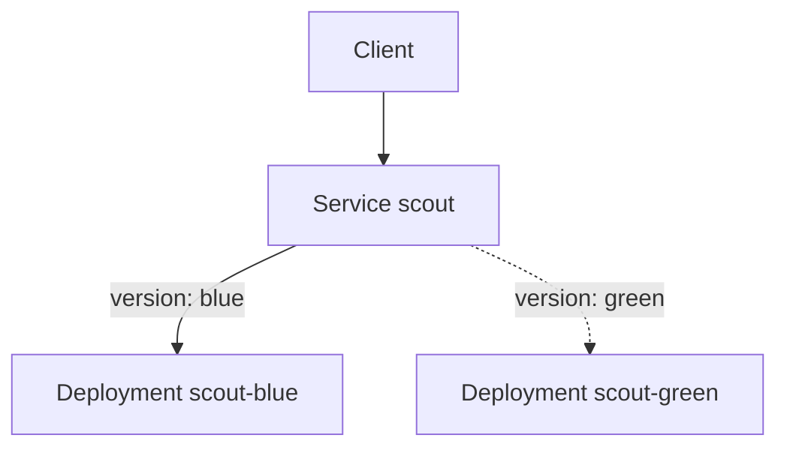

# Blue/Green With A Service Selector

A rolling update mixes old and new pods while it runs, and going back means another rollout. Some teams want to test the new version fully before any user reaches it, and to return to the old version in seconds. Blue/green delivery gives both.

This part explains the pattern, builds it with two Deployments and one Service, and describes what it costs.

## The pattern

In blue/green delivery, two complete environments run side by side. The **blue** environment serves users now. The **green** environment runs the new version with the full number of replicas, but receives no user traffic. The team tests green. When the tests pass, the router sends all traffic to green in one step. Blue stays running for a while, so going back is the same single step in the other direction.

In Kubernetes, a Service sends traffic to the pods whose labels match its selector. Changing the selector changes which pods receive traffic. The Service is the router.



The diagram shows one Service with two possible targets. The solid arrow is the live selector, and the dotted arrow is the switch that the team can make.

## Build it

<!-- astrona:playground:renew -->
Save this as `deployment-scout-blue.yaml`:

```yaml
apiVersion: apps/v1
kind: Deployment
metadata:
  name: scout-blue
  namespace: starfleet
spec:
  replicas: 2
  selector:
    matchLabels:
      app: scout
      version: blue
  template:
    metadata:
      labels:
        app: scout
        version: blue
    spec:
      containers:
        - name: scout
          image: ghcr.io/stefanprodan/podinfo:6.14.0
          ports:
            - name: http
              containerPort: 9898
          readinessProbe:
            httpGet:
              path: /readyz
              port: http
          resources:
            requests:
              cpu: 10m
              memory: 32Mi
```

Apply it:

```sh
kubectl apply -f deployment-scout-blue.yaml
```

Save this as `deployment-scout-green.yaml`. It differs in the name, the label `version: green` and the image:

```yaml
apiVersion: apps/v1
kind: Deployment
metadata:
  name: scout-green
  namespace: starfleet
spec:
  replicas: 2
  selector:
    matchLabels:
      app: scout
      version: green
  template:
    metadata:
      labels:
        app: scout
        version: green
    spec:
      containers:
        - name: scout
          image: ghcr.io/stefanprodan/podinfo:6.15.0
          ports:
            - name: http
              containerPort: 9898
          readinessProbe:
            httpGet:
              path: /readyz
              port: http
          resources:
            requests:
              cpu: 10m
              memory: 32Mi
```

Apply it:

```sh
kubectl apply -f deployment-scout-green.yaml
```

The playground already has a Service named `scout` whose selector is `app: scout`. That selector matches both versions. Save this as `service-scout-blue.yaml` to send traffic to blue only:

```yaml
apiVersion: v1
kind: Service
metadata:
  name: scout
  namespace: starfleet
spec:
  selector:
    app: scout
    version: blue
  ports:
    - name: http
      port: 80
      targetPort: http
```

Apply it and look at the endpoints:

```sh
kubectl apply -f service-scout-blue.yaml
kubectl -n starfleet get endpoints scout
```

The endpoints list the IP addresses of the two blue pods. Send a request from the client pod and read the version:

```sh
kubectl -n starfleet exec deploy/shuttle -- curl -s --max-time 5 http://scout/ | grep '"version"'
```

The answer shows the version 6.14.0.

## Switch and go back

Test green before the switch. A temporary check from inside the cluster can address a green pod directly by its IP address. After the tests pass, change the selector. A patch changes only that field:

```sh
kubectl -n starfleet patch service scout -p '{"spec":{"selector":{"app":"scout","version":"green"}}}'
```

The Service controller updates the endpoints within a moment, and the same request now shows 6.15.0. To go back, patch the selector to `blue` again. Nothing restarts, so the rollback takes seconds.

## What it costs

Blue/green needs twice the capacity while both environments run. It also needs a plan for state: both versions use the same database, so a schema change must work for both. Users in the middle of a session may reach a different version after the switch, and long connections stay on the old pods until they close.

After the new version has run safely for a while, remove the old environment or scale it to zero. Keep it until the team is sure it needs no rollback.

## Common pitfalls

> [!WARNING]
> A Service selector that lists only `app: scout` matches both colors and splits traffic between them. The selector of a Deployment cannot be changed after creation, so the color label must be in the Deployment from the start. Both environments share the database, so a breaking schema change breaks the old color too. Deleting the old color too early removes the fast rollback.
