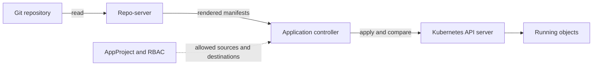

# GitOps Principles And The Components That Implement Them

GitOps is a way to operate a system in which the desired state lives in Git and an agent makes the running system match it. This part names the four principles, maps each to a component of a real setup, and shows what the agent manages, what it needs before it can start, and what happens to the running system when a piece is missing.

## The four principles

The OpenGitOps working group states four principles. Each one removes a specific failure of the older style, in which a person or a pipeline ran commands against a cluster.

1. **Declarative.** The desired state is written as data that describes the result, for example Kubernetes manifests, and not as a list of steps. Data can be compared with the running system. A list of steps cannot.
2. **Versioned and immutable.** The desired state is stored so that every change is a new, recorded version and old versions are kept. Git gives this: each commit has an ID computed from its content, an author and a parent.
3. **Pulled automatically.** An agent reads the desired state from the store. Nothing outside pushes changes into the system.
4. **Continuously reconciled.** The agent keeps comparing the running state with the desired state and acts on the difference, for as long as it runs and not only when a change arrives.

A setup that misses one of them is something else. Manifests in Git that a pipeline applies with `kubectl` are declarative and versioned, and they are pushed and not reconciled, so the cluster can drift away from Git without anyone noticing.

## The components



- **The store** is the Git repository. It holds the desired state and its history. It is the only input that a person changes.
- **The agent** is Argo CD. Its parts have separate jobs. The repo-server clones repositories and renders manifests, and it holds no cluster credentials. The application controller compares the rendered manifests with the live objects and applies the difference. The API server of Argo CD serves the web page and the command line. A Redis instance caches data. Other parts are optional: Dex for single sign-on, the notifications controller for messages and the ApplicationSet controller, which generates Applications from templates.
- **The runtime** is the cluster that the objects run in. For Argo CD it is a destination, named by an API server address and a namespace.
- **The policy** limits what the agent may do: which repositories an Application may read, which destinations it may write to, which kinds of objects it may create. In Argo CD this is the AppProject. Around it sit Kubernetes RBAC, which limits the service account of the controller, and the permissions of the Git host, which decide who may change the desired state.

## What the agent manages

The unit of management is the **Application**. It names one source, a repository, a revision and a path, and one destination. The controller manages the objects that the source renders, and only those. It marks each object it creates with a tracking annotation, `argocd.argoproj.io/tracking-id`, whose value starts with the name of the Application. Objects without the mark are not its objects, even in the same namespace.

The agent runs in one cluster and can manage that cluster through the address `https://kubernetes.default.svc`. To manage another cluster, the agent needs credentials for it, stored as a Secret in its own namespace. The agent that holds credentials for many clusters is a powerful target, which is why the policy boundary exists.

## What has to exist first

Argo CD manages Applications, and Applications are objects in the cluster, so something has to exist before the first Application: the installation of Argo CD itself and the credentials for the repository. A person or a bootstrap script creates these once. After that, Argo CD can manage its own configuration from Git, but the first installation is always outside the loop. A design that hides this dependency fails at the worst time, when the agent is gone and nothing can bring it back.

The agent also depends on systems that it does not own. The Git host must answer or no change arrives. If it is down, the running objects continue to run unchanged, no delivery happens and the Application status shows an error about the repository. The cluster API must answer or nothing can be compared.

## What happens when a piece fails

| Piece that fails | Effect on the running objects | Effect on delivery |
| --- | --- | --- |
| Git host | None. They keep running. | No new change is read. The Application shows a repository error. |
| Repo-server | None. | No manifests are rendered, so nothing can be compared or synced. |
| Application controller | None. | No comparison and no sync until it returns. |
| Cluster API server | The objects may still run, but nothing can change them. | Comparison and sync fail. |

In every row the workload keeps running. The agent is the delivery path and not the data path, so an outage of the agent stops change and does not stop service.

<!-- astrona:playground:renew -->
## Try it: find the components and see drift

List the parts of the agent. The pods run in the namespace `argocd`:

```sh
kubectl -n argocd get deploy,statefulset
```

The list shows the application controller, the repo-server, the API server, Redis and the ApplicationSet controller. Dex and the notifications controller are present with zero replicas in this playground.

Read what the Application manages and how it syncs:

```sh
kubectl -n argocd get application scout-staging -o jsonpath='{.spec.source.path}{" -> "}{.spec.destination.namespace}{"\n"}{.spec.syncPolicy}{"\n"}'
```

The source path is `overlays/staging`, and the sync policy has an `automated` block with no `selfHeal` and no `prune`. Now look for the mark of ownership:

```sh
kubectl -n starfleet-staging get deploy scout -o jsonpath='{.metadata.annotations.argocd\.argoproj\.io/tracking-id}{"\n"}'
```

The value starts with `scout-staging:`. Now change the running system without Git. Scale the Deployment by hand, wait about 30 seconds and read the sync status and the replicas:

```sh
kubectl -n starfleet-staging scale deploy/scout --replicas=3
kubectl -n argocd get application scout-staging -o jsonpath='{.status.sync.status}{"\n"}'
kubectl -n starfleet-staging get deploy scout
```

The sync status becomes `OutOfSync`, because the live Deployment has three replicas and Git says one. The Deployment keeps three replicas. The agent noticed the difference and did not undo it, because the policy `automated` without `selfHeal` acts on new commits and not on live changes. Restore the match by hand:

```sh
kubectl -n starfleet-staging scale deploy/scout --replicas=1
```

## Common pitfalls

> [!WARNING]
> A setup is GitOps only if the agent reconciles continuously. Reading Git once and applying it is a pipeline. Do not assume that automated sync undoes changes made in the cluster: without `selfHeal`, the Application only reports `OutOfSync`. Also remember that the first installation of the agent is never delivered by the agent itself.
