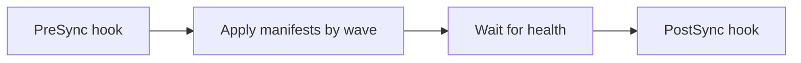

# Sync Waves And Hooks

Argo CD applies all objects of an Application in one sync, but some objects depend on others. A database migration must finish before the new version starts, and a namespace or a custom resource definition must exist before objects that use it. If everything is applied at once, the new version can fail on a schema that is not ready.

This part shows the two tools that order a sync: sync waves, which set the order of normal objects, and hooks, which run one-time tasks at defined points.

## Sync waves

A **sync wave** is a number in the annotation `argocd.argoproj.io/sync-wave`. Argo CD applies the objects with the lowest wave first and waits until they are healthy before it moves to the next wave. The default wave is 0, and negative numbers are allowed.

```yaml
metadata:
  annotations:
    argocd.argoproj.io/sync-wave: "-1"
```

The value is a string in quotes. Objects in the same wave are applied together. Argo CD also has a built-in order inside a wave: namespaces first, then custom resource definitions, then other kinds in a fixed order, so waves only matter when your own dependencies differ from that order.

## Hooks

A **hook** is an object, usually a Job, that Argo CD runs at a point of the sync and not as part of the application. The annotation `argocd.argoproj.io/hook` names the point.

- `PreSync` runs before the manifests are applied. A database migration is the typical use.
- `Sync` runs together with the manifests, in its wave.
- `PostSync` runs after all objects are healthy. A smoke test is the typical use.
- `SyncFail` runs when the sync fails. A notification or a cleanup fits here.

A hook that is a Job must finish with success for the sync to continue. If a PreSync hook fails, Argo CD stops the sync and the Deployment is not touched. That is the property that makes migrations safe: the application does not update on top of a failed migration.

The annotation `argocd.argoproj.io/hook-delete-policy` says when Argo CD deletes the hook object: `HookSucceeded` after success, `HookFailed` after failure, or `BeforeHookCreation` before the next run creates it again. Without a policy, old Jobs stay and the next sync fails because a Job of the same name exists. Use `BeforeHookCreation` or `HookSucceeded`.



The diagram shows the order of one sync. A failure in any box stops the later boxes.

## Add a PreSync hook

<!-- astrona:playground:renew -->
In your clone of the repository, save this as `overlays/staging/presync-check.yaml`:

```yaml
apiVersion: batch/v1
kind: Job
metadata:
  name: scout-presync-check
  annotations:
    argocd.argoproj.io/hook: PreSync
    argocd.argoproj.io/hook-delete-policy: BeforeHookCreation
spec:
  backoffLimit: 0
  template:
    spec:
      restartPolicy: Never
      containers:
        - name: check
          image: curlimages/curl:8.22.0
          command: ["sh", "-c", "echo schema check passed"]
```

Save this as `overlays/staging/kustomization.yaml`, which adds the Job to the resources:

```yaml
apiVersion: kustomize.config.k8s.io/v1beta1
kind: Kustomization
namespace: starfleet-staging
resources:
  - ../../base
  - presync-check.yaml
labels:
  - pairs:
      environment: staging
images:
  - name: ghcr.io/stefanprodan/podinfo
    newTag: 6.14.0
replicas:
  - name: scout
    count: 1
patches:
  - path: message.yaml
```

Commit and push the change, and ask Argo CD to refresh:

```sh
git add overlays/staging
git -c user.name=ci -c user.email=ci@starfleet.local commit -m "add presync check to staging"
git push origin main
kubectl -n argocd annotate application scout-staging argocd.argoproj.io/refresh=hard --overwrite
```

With the automated sync policy, Argo CD starts a sync for the new commit. Read the result of the last operation, which lists each resource and its hook phase:

```sh
kubectl -n argocd get application scout-staging -o jsonpath='{range .status.operationState.syncResult.resources[*]}{.kind}{"\t"}{.name}{"\t"}{.hookType}{"\t"}{.hookPhase}{"\n"}{end}'
```

The row for the Job shows the hook type `PreSync` and the phase `Succeeded`. The Deployment and Service rows have no hook type. If the command shows nothing, the sync has not finished yet; run it again after a few seconds.

## Waves together with hooks

A hook also has a wave. Within the PreSync phase, hooks run in wave order, so a "create database" hook can come before a "migrate schema" hook. Choose a small number of waves and name the reason in a comment, because a repository with many waves is hard to reason about.

Ordering decides when objects are applied. The next question is what counts as done, which is the job of health checks.

## Common pitfalls

> [!WARNING]
> A hook Job without a delete policy blocks the next sync because the old Job still exists. A failing PreSync hook stops the whole sync, so a flaky check blocks every release. Sync wave numbers are strings and need quotes. A hook is not part of the desired state, so it does not show in the diff of the Application.
