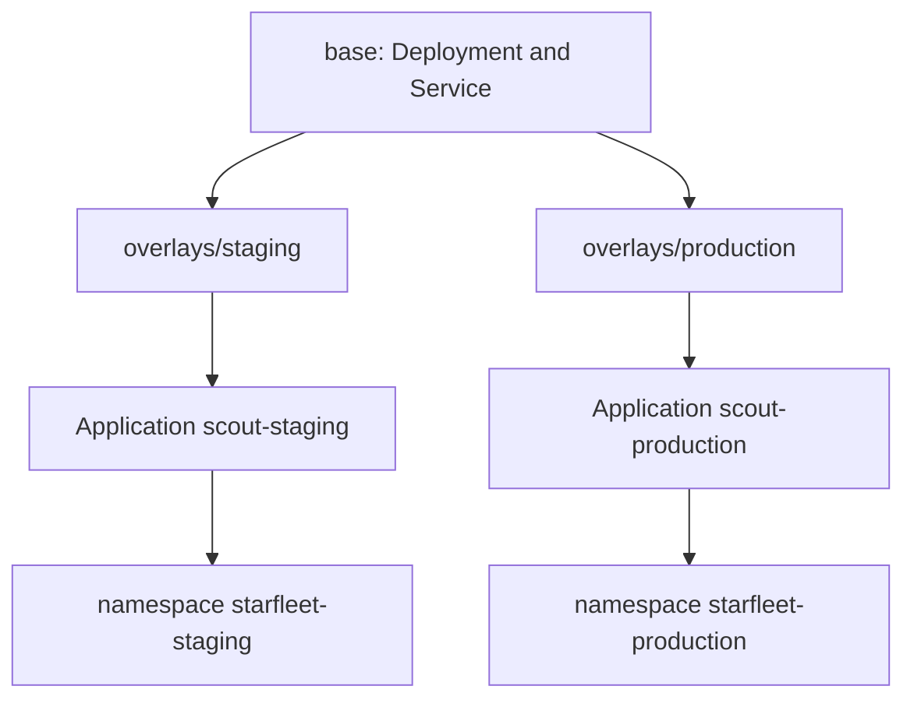

# Environments, Projects And The Deletion Lifecycle

A team that runs one service in several environments needs a repeatable way to describe them. This part shows the common layout, one overlay and one Application per environment, explains how a project limits the whole team, and follows the life of an Application to its end: what its status tells, and what deleting it does to the objects it created.

## One overlay, one namespace, one Application per environment

The repository holds a `base` with the parts that every environment shares, here a Deployment and a Service. Each environment has an overlay, a directory that builds on the base and changes only what differs: the namespace, the replica count, the image tag and a few settings. Kustomize renders `base` plus the overlay into the final manifests.



Each Application reads one overlay and writes one namespace. The pair is the whole definition of the environment, which has three consequences. A change to one overlay moves only its environment. A promotion is a change to the overlay of the next environment, and nothing else. The state of each environment can be asked for separately, because each has its own status.

## The project as the team boundary

The Applications of one team belong to one AppProject. The project states what the team may do: which repositories it may read, which namespaces it may write to and which kinds of objects it may create. A project for the scout team lists the repository and the namespaces of the environments that the team owns, and nothing else. An Application that points elsewhere gets the condition `InvalidSpecError`, and nothing is applied. The project is therefore the place to look when the question is whether a team could have touched an environment.

A project can also hold roles and sync windows, which allow or deny syncs at certain times. They are outside the scope of this module.

## What the status of an Application tells

The status answers the questions of an operator without opening the cluster.

- `status.sync.status` and `status.sync.revision`: whether the live objects match, and which commit was compared.
- `status.health.status`: whether the objects work.
- `status.resources`: one entry for each managed object with its own sync and health.
- `status.history`: the successful syncs.
- `status.conditions`: problems such as `InvalidSpecError` or a comparison error.

The same information is shown as a resource tree in the web page.

## The lifecycle ends with a deletion

Deleting an Application is a decision about two things: the Application, and the objects it created. Argo CD makes the choice with a finalizer. A finalizer is a name in `metadata.finalizers` that blocks the removal of an object until a controller has done its cleanup and removed the name.

- **With** the finalizer `resources-finalizer.argocd.argoproj.io`, deleting the Application first deletes the objects that it manages (a cascading delete), and then the Application. The default propagation is foreground.
- **Without** the finalizer, deleting the Application removes only the Application. The Deployment and the Service stay in the namespace, still carrying the tracking annotation, and nobody manages them any more. Such objects are called orphans.

Neither is right for every case. Some teams keep the objects of production when a mistake deletes the Application, so they leave the finalizer off. A short-lived preview environment should be cleaned up completely, so it needs the finalizer. The examples in this module put the finalizer on production to show the cascade, and leave it off on preview to show the orphans. The choice must be made when the Application is created, because the finalizer is on the object and not in a setting that can be read from elsewhere.

A namespace that Argo CD created with `CreateNamespace=true` is not deleted with the Application. Only the objects that the Application renders are.

<!-- astrona:playground:renew -->
## Try it: a project, two Applications and two ways to delete

Create the project for the team. Save this as `scout-team.yaml`:

```yaml
apiVersion: argoproj.io/v1alpha1
kind: AppProject
metadata:
  name: scout-team
  namespace: argocd
spec:
  description: The scout team and its environments
  sourceRepos:
    - http://gitea-http.gitea.svc:3000/starfleet/scout-deploy.git
  destinations:
    - server: https://kubernetes.default.svc
      namespace: starfleet-staging
    - server: https://kubernetes.default.svc
      namespace: starfleet-production
    - server: https://kubernetes.default.svc
      namespace: starfleet-preview
```

Save this as `scout-production.yaml`, an Application with the finalizer:

```yaml
apiVersion: argoproj.io/v1alpha1
kind: Application
metadata:
  name: scout-production
  namespace: argocd
  finalizers:
    - resources-finalizer.argocd.argoproj.io
spec:
  project: scout-team
  source:
    repoURL: http://gitea-http.gitea.svc:3000/starfleet/scout-deploy.git
    targetRevision: main
    path: overlays/production
  destination:
    server: https://kubernetes.default.svc
    namespace: starfleet-production
  syncPolicy:
    automated:
      prune: true
      selfHeal: true
```

Save this as `scout-preview.yaml`, the same shape without the finalizer:

```yaml
apiVersion: argoproj.io/v1alpha1
kind: Application
metadata:
  name: scout-preview
  namespace: argocd
spec:
  project: scout-team
  source:
    repoURL: http://gitea-http.gitea.svc:3000/starfleet/scout-deploy.git
    targetRevision: main
    path: overlays/preview
  destination:
    server: https://kubernetes.default.svc
    namespace: starfleet-preview
  syncPolicy:
    automated:
      prune: true
      selfHeal: true
```

Apply them:

```sh
kubectl apply -f scout-team.yaml
kubectl apply -f scout-production.yaml -f scout-preview.yaml
```

Check it: wait until both are `Synced` and `Healthy`, and read the tracking annotation of each Deployment.

```sh
kubectl -n argocd get applications
kubectl -n starfleet-production get deploy scout -o jsonpath='{.metadata.annotations.argocd\.argoproj\.io/tracking-id}{"\n"}'
kubectl -n starfleet-preview get deploy scout -o jsonpath='{.metadata.annotations.argocd\.argoproj\.io/tracking-id}{"\n"}'
```

The values start with `scout-production:` and `scout-preview:`. Now delete the Application without the finalizer, and look at the namespace:

```sh
kubectl -n argocd delete application scout-preview
kubectl -n starfleet-preview get deploy,svc
```

The Application is gone, and the Deployment and the Service remain, as orphans. Now delete the Application with the finalizer:

```sh
kubectl -n argocd delete application scout-production
kubectl -n starfleet-production get deploy,svc
```

The delete command waits for the cleanup, and the namespace is empty afterwards. The namespace itself still exists, because it was created outside the Application.

## Common pitfalls

> [!WARNING]
> Deleting an Application without the finalizer leaves orphaned objects that keep running and that nothing reconciles. Deleting one with the finalizer deletes everything it created, including objects that hold data. Decide per environment, write the decision into the Application when it is created, and review deletions of Applications like deletions of the environment itself.
