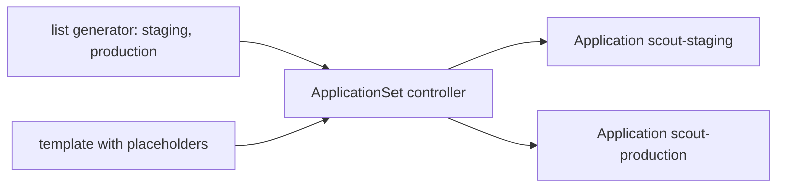

# ApplicationSets: Generating Environments

Writing one Application for each environment works for two environments and becomes error-prone for ten: the Applications drift apart in small ways, and a new environment means copying a file and editing it by hand. An ApplicationSet replaces the copies with one template and a list of the things that vary. This part explains the mechanism, shows what is created and who owns it, and follows what happens when an element is added or removed.

## The pieces of an ApplicationSet

An ApplicationSet is an object that the ApplicationSet controller watches. It has two main parts.

- **Generators** produce a list of parameter sets. Each set is a small map of keys and values. The **list generator** takes them from `elements` written in the object itself. Other generators read them from a directory structure in Git, from a list of registered clusters, or from a pull request API.
- **The template** is an Application with placeholders. For each parameter set, the controller fills the placeholders and creates one Application.

With `goTemplate: true`, the placeholders use the Go template syntax, such as `{{.env}}`, which allows conditions and functions. The option `goTemplateOptions: ["missingkey=error"]` turns a misspelled key into an error, and without it a missing key silently renders as an empty value or the text `<no value>`.



## Ownership and the life of generated Applications

The controller creates the Applications with an owner reference to the ApplicationSet, and it keeps them equal to the template. If a person edits a generated Application, the controller overwrites the edit at its next pass. The ApplicationSet is therefore the only place to change a generated Application.

The generated list drives creation and deletion.

- Adding an element creates one Application.
- Changing the template changes every generated Application.
- Removing an element deletes the Application that it produced. What happens to the objects of that Application depends on its finalizer, which is part of the template. With the finalizer `resources-finalizer.argocd.argoproj.io` in the template, removing an element removes the environment, with its objects. Without it, the objects are left behind as orphans.
- The field `preserveResourcesOnDeletion: true` in the `syncPolicy` of the ApplicationSet keeps the objects when an Application is removed, even when the finalizer is in the template.

Deleting the ApplicationSet itself deletes all of its Applications in the same way.

The ApplicationSet adds one more risk: a single mistake affects every environment. A wrong path in the template breaks all of them at once, and a removed element removes an environment. The projects, the review of changes to the ApplicationSet in Git and the finalizer policy are the controls.

<!-- astrona:playground:renew -->
## Try it: one template, three environments, then two

Create the project that the Applications will use. Save this as `scout-team.yaml`:

```yaml
apiVersion: argoproj.io/v1alpha1
kind: AppProject
metadata:
  name: scout-team
  namespace: argocd
spec:
  description: The scout team and its environments
  sourceRepos:
    - http://gitea-http.gitea.svc:3000/starfleet/scout-deploy.git
  destinations:
    - server: https://kubernetes.default.svc
      namespace: starfleet-staging
    - server: https://kubernetes.default.svc
      namespace: starfleet-production
    - server: https://kubernetes.default.svc
      namespace: starfleet-preview
```

Save this as `scout-envs.yaml`:

```yaml
apiVersion: argoproj.io/v1alpha1
kind: ApplicationSet
metadata:
  name: scout-envs
  namespace: argocd
spec:
  goTemplate: true
  goTemplateOptions: ["missingkey=error"]
  generators:
    - list:
        elements:
          - env: staging
          - env: production
          - env: preview
  template:
    metadata:
      name: 'scout-{{.env}}'
      finalizers:
        - resources-finalizer.argocd.argoproj.io
    spec:
      project: scout-team
      source:
        repoURL: http://gitea-http.gitea.svc:3000/starfleet/scout-deploy.git
        targetRevision: main
        path: 'overlays/{{.env}}'
      destination:
        server: https://kubernetes.default.svc
        namespace: 'starfleet-{{.env}}'
      syncPolicy:
        automated:
          prune: true
          selfHeal: true
```

Apply them:

```sh
kubectl apply -f scout-team.yaml
kubectl apply -f scout-envs.yaml
```

Check it: three Applications appear, and each one is owned by the ApplicationSet.

```sh
kubectl -n argocd get applications
kubectl -n argocd get application scout-preview -o jsonpath='{.metadata.ownerReferences[0].kind}{" "}{.metadata.ownerReferences[0].name}{"\n"}'
```

The owner is the kind `ApplicationSet` with the name `scout-envs`. Wait until all three are `Synced` and `Healthy`. Now try to edit a generated Application by hand, and then read it again after a few seconds:

```sh
kubectl -n argocd patch application scout-preview --type merge -p '{"spec":{"source":{"targetRevision":"HEAD"}}}'
kubectl -n argocd get application scout-preview -o jsonpath='{.spec.source.targetRevision}{"\n"}'
```

The controller sets the value back to `main`, because the template says so. Now retire the preview environment by removing its element. Save this as `scout-envs.yaml`:

```yaml
apiVersion: argoproj.io/v1alpha1
kind: ApplicationSet
metadata:
  name: scout-envs
  namespace: argocd
spec:
  goTemplate: true
  goTemplateOptions: ["missingkey=error"]
  generators:
    - list:
        elements:
          - env: staging
          - env: production
  template:
    metadata:
      name: 'scout-{{.env}}'
      finalizers:
        - resources-finalizer.argocd.argoproj.io
    spec:
      project: scout-team
      source:
        repoURL: http://gitea-http.gitea.svc:3000/starfleet/scout-deploy.git
        targetRevision: main
        path: 'overlays/{{.env}}'
      destination:
        server: https://kubernetes.default.svc
        namespace: 'starfleet-{{.env}}'
      syncPolicy:
        automated:
          prune: true
          selfHeal: true
```

Apply it and check the result:

```sh
kubectl apply -f scout-envs.yaml
kubectl -n argocd get applications
kubectl -n starfleet-preview get deploy,svc
```

After a short time the Application `scout-preview` is gone, and, because the template carries the finalizer, the Deployment and the Service in `starfleet-preview` are gone too. The other two Applications are untouched.

## Common pitfalls

> [!WARNING]
> A mistake in an ApplicationSet affects every environment at once, so review changes to it like changes to production. Removing an element removes an Application, and with the finalizer in the template it also removes the objects. Never edit a generated Application and expect the edit to stay. Use `missingkey=error` so that a misspelled placeholder fails loudly instead of rendering an empty path.
