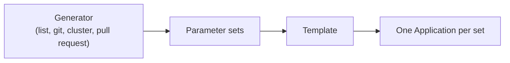

# Choosing An ApplicationSet Generator

An ApplicationSet has two parts: a **generator** that produces a list of parameter sets, and a **template** that is filled once for each set. The controller creates one Application per set. Everything about which Applications exist comes from the generator, so choosing the right generator decides how much manual work is left.

## The common generators

- **List** holds the parameter sets in the ApplicationSet itself. It is the simplest generator and fits a small fixed set of environments. Every new environment is an edit of the ApplicationSet.
- **Cluster** produces one set for each cluster registered in Argo CD. It fits "deploy the same thing to every cluster", and a label selector narrows it to some clusters.
- **Git directory** produces one set for each folder that matches a path in a repository. A new folder becomes a new Application, so adding an environment is a commit in the application repository.
- **Git file** reads JSON or YAML files in a repository and produces one set for each file or each entry. It fits environments with settings, such as a replica count or a domain, kept next to the manifests.
- **Pull request** produces one set for each open pull request in a hosting service. It creates a preview environment while the pull request is open and removes it when the request closes.
- **SCM provider** produces one set for each repository of an organisation in a hosting service.
- **Matrix** and **merge** combine other generators. They are covered in the next part.



The diagram shows the flow: only the generator differs between the types, and the template and the result stay the same.

## Choose by who decides

A useful question is who decides that an environment exists.

- If the platform team decides, a list in the ApplicationSet is clear and reviewed.
- If a team decides by adding a folder, the Git directory generator removes the platform team from the path.
- If an event decides, such as an open pull request, the pull request generator ties the lifetime of the environment to that event.
- If a cluster joining the fleet decides, the cluster generator does it.

## Template variables

Every key of a parameter set is available in the template. The Go template mode, turned on with `goTemplate: true`, writes them as `{{ .name }}`. Without it the older syntax is `{{name}}`. Use Go templates in new work, because they allow conditions and functions. Add `goTemplateOptions: ["missingkey=error"]` so that a misspelled key fails at once and does not produce an empty value.

## See the generator types

<!-- astrona:playground:renew -->
List the generator kinds that the installed controller knows by reading its CRD schema:

```sh
kubectl get crd applicationsets.argoproj.io -o jsonpath='{.spec.versions[0].schema.openAPIV3Schema.properties.spec.properties.generators.items.properties}' | jq 'keys'
```

The output lists names such as `clusters`, `git`, `list`, `matrix`, `merge`, `pullRequest` and `scmProvider`. Each is one generator type.

## Common pitfalls

> [!WARNING]
> A generator that returns no sets removes every Application that it created earlier, unless the policy says otherwise. A missing template key renders an empty value unless `missingkey=error` is set. A pull request generator needs a token for the hosting service, and hitting the rate limit of that service stops the updates.
